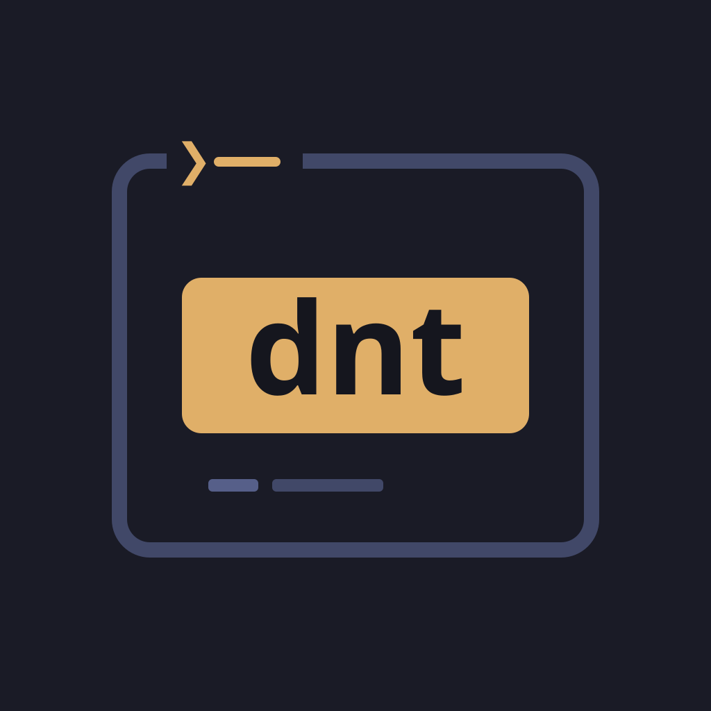

# Dungeons & Terminals



`dnt` is a D&D 5e companion for players, in the terminal: a compendium,
character sheets that do the maths, dice, campaign notes and campaign
homebrew. It reads the rules from a data directory you provide, in the
JSON format described in [`schemas/`](schemas/README.md), and works with
the 2024 and the 2014 rules. dnt ships no game content.

There is also **the dnt app** for Windows and Android (phones and
tablets): the same compendium, campaigns, characters and notes, in the
look of the terminal, made for touch. See [The app](#the-app-windows-and-android).

- **Compendium** — fuzzy search over spells, classes, species, feats,
  items and rules, with filters (`@XPHB #spell ^3 *fire "concentration"`),
  links you can follow, and every specific magic item (+1 Longsword,
  Flame Tongue Greatsword).
- **Characters** — a creation wizard, multiclassing and level-ups with
  every choice, and a sheet that explains each number: abilities, skills,
  attacks (proficiency, finesse, magic bonuses, fighting styles, monk
  weapons, two weapons), extra damage on a hit, resources, spell slots,
  spells with their damage, equipment slots and hands, containers.
- **Play** — roll checks, saves, attacks, damage and spells from the
  sheet, with advantage, critical hits, conditions and exhaustion; rest,
  take damage, track concentration; the rolls can go into the session
  note.
- **Notes** — a campaign notebook in Markdown with links (`[[Strahd]]`,
  `[[spell:Fireball]]`), backlinks, session notes, quick capture and
  live query blocks.
- **Homebrew** — clone any entry into the campaign (replacing the book
  version or as a copy), edit it in forms, create new items and spells,
  and share them across campaigns.
- **Rules** — automate class features, feats and species with small
  TOML rules, written and checked from inside the app.
- **Export** — a character sheet as Markdown or a printable page (PDF
  from the browser).

## Getting started

Download the binary from the
[latest release](https://github.com/v0v3s/dungeons-n-terminals/releases/latest),
or build it. Either way you need the data (see
[`schemas/README.md`](schemas/README.md) for the layout): import a zip of
it once with `dnt import data.zip`, or point dnt at a data folder with
`--data`. [`scripts/pack-data.sh`](#data-in-one-zip) makes a small zip of
just what dnt reads.

```sh
# Linux
curl -LO https://github.com/v0v3s/dungeons-n-terminals/releases/latest/download/dnt-linux-x86_64
chmod +x dnt-linux-x86_64 && mv dnt-linux-x86_64 ~/.local/bin/dnt
```

On Windows, download `dnt-windows-x86_64.exe` (rename it to `dnt.exe` if
you like) and run it in Windows Terminal. Each release also has
`SHA256SUMS` to check the download.

To build it yourself you need [Rust](https://rustup.rs):

```sh
git clone https://github.com/v0v3s/dungeons-n-terminals.git
cd dungeons-n-terminals
cargo build --release
./target/release/dnt import data.zip   # or: ./target/release/dnt --data /path/to/data
./target/release/dnt
```

A data path is remembered, so afterwards `dnt` is enough. Without data,
dnt starts with **Getting started**, which asks for a zip to import (or
a data folder). Then you land in **Campaigns** (`4`): press `n` to create
one (all official sources; `tab` to change its books or homebrew), and
go to **Characters** (`2`) and press `n`. `D` deletes a campaign.

Press `?` on any screen for its keys (F1 works while typing too).

### Command line

| Option | |
| --- | --- |
| `--data PATH` | the data directory (or a folder with it as `data/`); also `DNT_DATA` |
| `--homebrew FILE` | load a homebrew JSON file for this run (repeatable) |
| `--sources XPHB,XDMG` | use these sources instead of the campaign's |
| `--show-reprinted` | with `--sources`: keep entries that were reprinted |
| `import FILE.zip` | import data: a whole data folder, or homebrew files in any layout |
| `imported` | list the imported sources |
| `forget SOURCE` | remove an imported source (or homebrew source) |
| `forget --homebrew` · `forget --all` | remove all imported homebrew · everything imported (campaigns stay) |
| `reset` | start over: delete the data, every campaign and the configuration (asks first) |

Importing merges entries by who they are (kind, name, source), so
importing the same zip again, or a newer version of a homebrew file,
updates entries instead of doubling them; entries a zip does not have
are kept. A configured data folder (`--data`) is used instead of the
imported data.

Homebrew files (files that name their sources in `_meta`) are kept
apart and are off until a campaign enables them: in **Campaigns**, `tab`
to the campaign's Homebrew and tick them with `space` (or tick them in
the app). So a whole homebrew collection can be imported
without slowing anything down.

### Data in one zip

To make one zip of just what dnt reads, from a data repository and/or
a homebrew collection (images, creatures and adventure text are left
out), run:

```sh
scripts/pack-data.sh --data path/to/data-repo --homebrew path/to/homebrew -o dnt-data.zip
```

It needs [Rust](https://rustup.rs) (it builds a small packer from this
repository) and takes a few seconds. The zip works with `dnt import` and
with the app.

## The app (Windows and Android)

Each release has the app next to the terminal binaries:

- **Windows** — `dnt-app-windows-x86_64-setup.exe`, an installer. It is
  not code-signed, so Windows SmartScreen asks first: *More info* ›
  *Run anyway*.
- **Android** — `dnt-app-android.apk`, for phones and tablets. Open it on
  the device and allow installing from that app (or
  `adb install -r dnt-app-android.apk`). It is signed with the project's
  own key, so newer releases install over older ones.

The app starts with **Getting started**: *Import a zip…* takes a zip like
the one `scripts/pack-data.sh` makes (put it on the phone first), then it
asks for a campaign's name; the campaign uses all official sources,
newest printings only. More data can be imported later under **Data**. The `@` button in the compendium (or *Sources* on a
campaign) chooses the books, and its **Homebrew** tab turns on imported
homebrew, which is off until you do. Campaigns, characters and notes live
in the app's own storage; the app and the terminal do not share them.

Building and running the app yourself is described in
[`app/README.md`](app/README.md).

## Where things are

Everything is plain files you can read, edit and back up:

```
~/.config/dnt/config.toml            the data path and the last campaign
~/.local/share/dnt/
  campaigns/<campaign>/
    campaign.toml                    name, sources, notes order
    characters/<name>.toml           one file per character
    homebrew.json                    the campaign's homebrew (see schemas/)
    notes/                           Markdown notes (Sessions/, NPCs/, …)
    exports/                         exported sheets
  library/
    imported/                        data imported from zips (one file per source)
      homebrew/                      imported homebrew, loaded where enabled
    homebrew/*.json                  homebrew shared by every campaign
    overlays/*.toml                  your rules for features
  templates/*.md                     your note templates (override the defaults)
```

(On macOS both are under `~/Library/Application Support/dnt`. The
`XDG_DATA_HOME` and `XDG_CONFIG_HOME` variables move them on Linux.
`DNT_HOME` moves them anywhere, on any system: the data into
`$DNT_HOME/data`, the config to `$DNT_HOME/config.toml`.)

`e` on a character opens its file in `$EDITOR`; changes are read back when
you return. Homebrew files are data files like any other (a `_meta` block
naming their sources, then entity lists), so you can share them or load
them with `--homebrew`.

## Rules (overlays)

A sheet knows a feature's numbers when there are rules for it. dnt ships
rules for many 2024 features (Rage, Sneak Attack, fighting styles, Lay on
Hands, Wild Shape, species traits, …); features with rules show `auto` in
the Features tab. For anything else, press `O` on the feature to write
its rules; the check pane shows what they change on the character as you
type. A rule file looks like this:

```toml
[[feature]]
id = "classFeature:Brutal Strike|Barbarian|XPHB|9"

[[feature.resource]]
key = "brutal_strike"
name = "Brutal Strike"
max = "prof"
recharge = "long_rest"

[[feature.effect]]
target = "rider.brutal_strike"        # extra damage on a hit
set = "if(class.barbarian.level >= 17, 2d10, 1d10)"
origin = "Brutal Strike: with Reckless Attack"
```

Targets include `ac`, `speed`, `hp.max`, `initiative`, `save.dex`,
`skill.stealth`, `attack.bonus`, `attack.melee.damage`,
`attack.ranged.bonus`, `attack.heavy.damage`, `rider.<key>` and
`resource.<key>.max`; effects `add`, `set`, `max`, `min` or `mul`, with an
optional `when` condition. Your file for a feature replaces dnt's
built-in rules for it.

## Development

The workspace has these crates:

- `dnt-data` — loading the data, entities, search, rendering entries
- `dnt-rules` — the rules engine, characters, attacks, spells, dice
- `dnt-store` — campaigns, characters, notes and homebrew on disk (or in memory)
- `dnt-core` — what any frontend needs: commands, level-up and creation
  flows, search, notes, the import, the workspace and sheet views
- `dnt` — the terminal app (ratatui)
- `dnt-app` (in `app/`) — the app: Tauri, with a Svelte frontend; see
  [`app/README.md`](app/README.md)

```sh
cargo test                                   # all crates, the terminal's end-to-end tests too
cargo run --example check_overlays -p dnt-rules -- /path/to/data
scripts/sandbox.sh /tmp/dnt-sandbox /path/to/data
XDG_DATA_HOME=/tmp/dnt-sandbox/data XDG_CONFIG_HOME=/tmp/dnt-sandbox/config cargo run -p dnt
DNT_HOME=/tmp/dnt-try cargo run -p dnt       # or everything in one folder, on any system
```

Every feature is tested end to end, the way it is used, on every target:
the terminal app in a pseudo-terminal, the app on an Android phone and on
Windows. The features are listed as scenarios in
[`e2e/scenarios.toml`](e2e/scenarios.toml), and a change that adds or
changes one adds its tests in the same change (`cargo test -p dnt --test
scenarios` checks it). The tests use invented test data
([`e2e/data`](e2e/data)); see [`e2e/README.md`](e2e/README.md).

The sandbox script makes a throwaway campaign with sample characters, so
you can try things without touching your own data. `vendor/edtui` is a
patched copy of the edtui editor (word-aware wrapping; see its
`PATCHES.md`). The design notes are in [DESIGN.md](DESIGN.md).

### Releases

Changes go in through pull requests, squash-merged, whose title is a
[Conventional Commit](https://www.conventionalcommits.org): it becomes the
commit on `main` and decides the release.

| PR title | Release |
| --- | --- |
| `feat: …` | minor (0.3.1 → 0.4.0) |
| `fix: …`, `perf: …` | patch (0.3.1 → 0.3.2) |
| `feat!: …`, or `BREAKING CHANGE:` in the description | major (0.3.1 → 1.0.0) |
| `docs:`, `chore:`, `ci:`, `refactor:`, `test:`, … | none |

A release gathers the work of a branch: keep a branch going until it is
worth releasing, then open one pull request for it. Write what it changes
for users under **Unreleased** in [CHANGELOG.md](CHANGELOG.md).

On a releasing merge, GitHub Actions bumps the version in `Cargo.toml`,
names the changelog's Unreleased section after it, tags `vX.Y.Z`, builds
the Linux and Windows (x86_64) binaries, the Windows installer and the
Android app, and publishes them as a release (with `SHA256SUMS`). The
release notes are that changelog section (or, if it was left empty, the
commit subjects). `scripts/next-version.sh "<title>"` shows what a title
would do. CI checks formatting, clippy and tests on Linux and Windows,
and builds the app, for every pull request.

dnt is a fan project and not affiliated with Wizards of the Coast; it
ships no game content and reads the data you provide.

The app's icons are by Lorc and Delapouite from
[game-icons.net](https://game-icons.net), under
[CC BY 3.0](https://creativecommons.org/licenses/by/3.0/)
(`app/src/lib/icons.ts`); the app credits them on its Data screen.

## License

MIT
