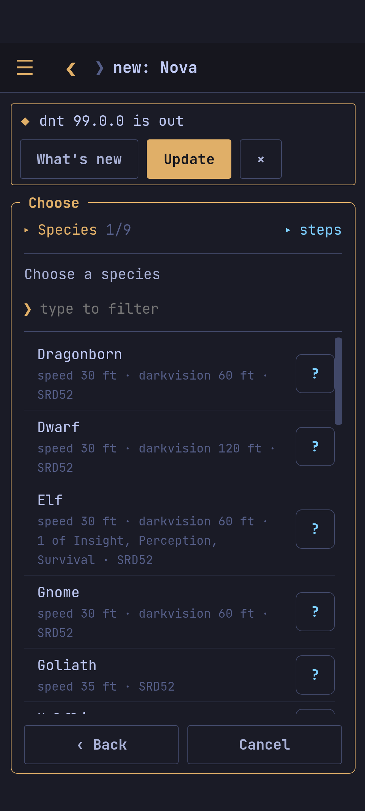
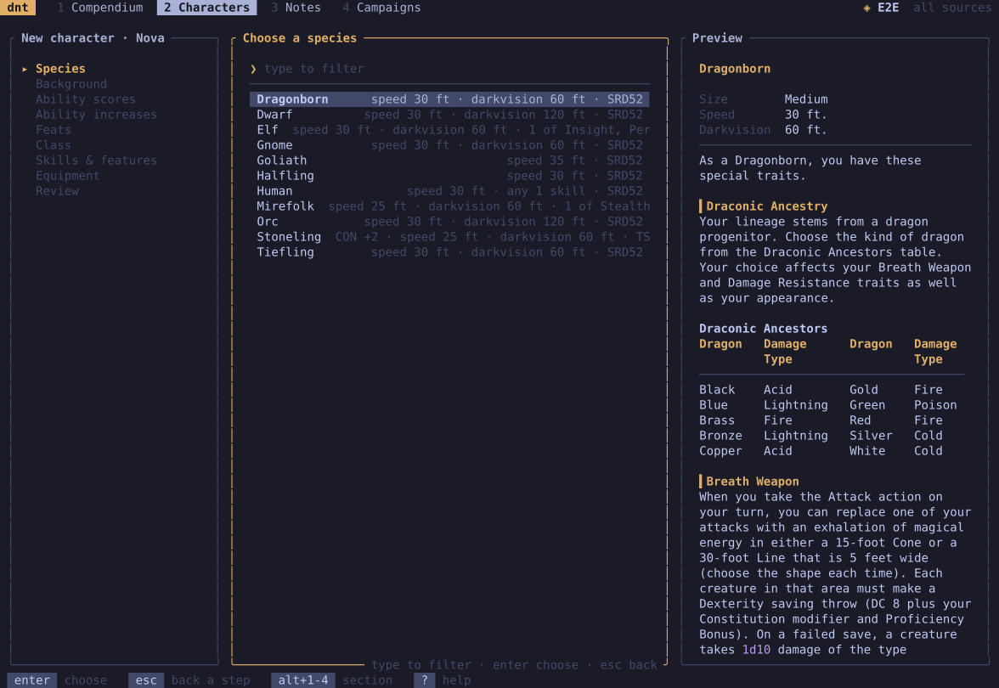
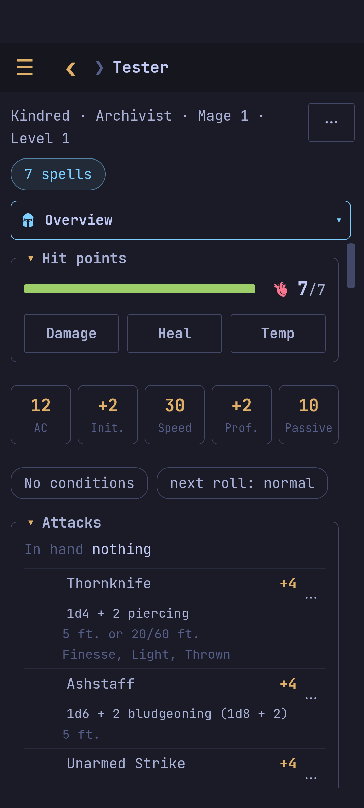

## Creating one

*+ New character* (in the terminal: **2 Characters**, `n`), a name, then
step by step: species (and a lineage or subrace), background, ability
scores (standard array, point buy or your own), the increases, an origin
feat, the class (and a subclass if it comes at level 1), skills, a
feature's choices, and the starting equipment. *Back* changes an answer.

| | |
| --- | --- |
|  |  |

## The sheet

Five tabs: **Overview** (hit points, abilities, skills, attacks, what you
track), **Features**, **Spells**, **Inventory** and **Notes**. Every number
explains itself: hold it on a phone (right-click on a desktop; `enter` in
the terminal) to see how it adds up.

The tab select above the sheet changes the tab. On a phone, swipe sideways
too: the gap names the tab you are going to, and lights up once letting go
opens it (a little under half the way). Unfold *Characters* in the menu (▸) for
the open character's tabs: from the compendium straight to their spells.

## Levels

*⋯ › Level up* (`u`): the class (the same or another, if your scores allow
it), hit points (average, the maximum, or what you rolled at the table),
the subclass, and an ability score improvement or a feat when they come.
*Remove the latest level* (`U`) undoes it. Choices left open (a character
file edited by hand) are made from the flag on the sheet (`c`).

## The file

A character is a plain TOML file: *⋯ › Edit the character file* (`e`, in
your `$EDITOR`). *Export* writes a printable page or Markdown (`X`).
Deleting asks first.

See also [[Playing]], [[Spells]], [[Inventory]].
