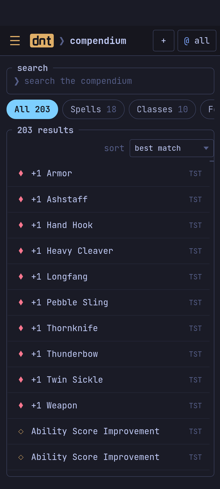
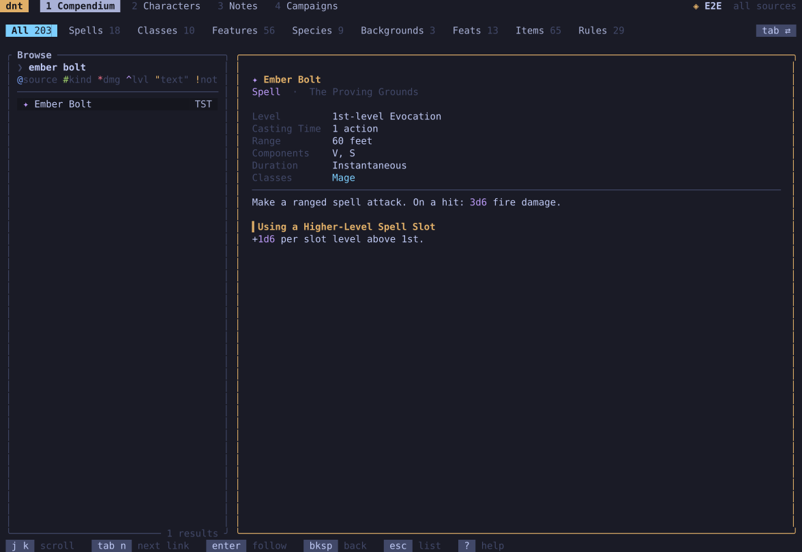

Every spell, class, species, background, feat, item and rule of the books
your campaign uses.

| | |
| --- | --- |
|  |  |

- **Search** as you type; narrow it with filters: `@XPHB` (a source),
  `#spell` (a kind), `^3` (a level), `*fire` (a damage type), `"text"` (in
  the text), `!` (not).
- **Categories** (`tab` in the terminal) and the **order**: best match,
  name, source, level or rarity (`o`).
- **Read** an entry and follow its links; *back* returns.
- **Clone** an entry into the campaign, as a campaign version that replaces
  the book's or as a copy with a new name (`c`), and switch between the
  campaign version and the book original (`o` in an entry).
- **New** homebrew from a template (`n`): see [[Homebrew and rules]].
