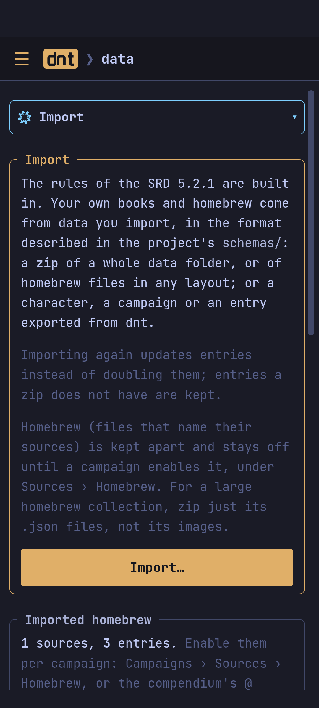

In the app, *Data* has it all in tabs: **Import** (zips of books,
homebrew or anything exported from dnt; what has been imported; starting
over), **Rules** (the [[Homebrew and rules|rules library]]), **Backups**,
**Problems** (only while there are some) and **About**. The menu lists them
under Data.



Everything is plain files you can read, edit and back up.

```
~/.config/dnt/config.toml            the data path and the last campaign
~/.local/share/dnt/
  campaigns/<campaign>/
    campaign.toml                    name, sources, notes order
    characters/<name>.toml           one file per character
    homebrew.json                    the campaign's homebrew
    notes/                           Markdown notes
    exports/                         exported sheets
  library/
    imported/                        data imported from zips
    homebrew/*.json                  homebrew shared by every campaign
    overlays/*.toml                  your rules for features
  templates/*.md                     your note templates
```

- On macOS both are under `~/Library/Application Support/dnt`; on Windows
  under `%APPDATA%\dnt`. `XDG_DATA_HOME` and `XDG_CONFIG_HOME` move them on
  Linux.
- **`DNT_HOME`** moves everything into one folder, on any system: the data
  into `$DNT_HOME/data`, the configuration to `$DNT_HOME/config.toml`. It
  works for the app on Windows too (a portable install, or a second setup to
  try things in).
- The app on Windows keeps its own in `%APPDATA%\cz.v0v3s.dnt`; on Android,
  in the app's storage.

**Versions**: character files, `campaign.toml` and the config start with
`format = 1`. A newer dnt reads what an older one wrote. A file synced from
a newer dnt than yours is left alone: the character list says it could not
be read and why; update dnt to open it.

## Backups

A backup is everything in one zip: campaigns with their characters, notes
and homebrew, the imported data, your homebrew, rules and templates, and
the settings. It restores on another device with nothing else.

- **By hand**: *Data › Back up now* in the app, `dnt backup [FILE]` in the
  terminal.
- **By itself**: when dnt starts, every day, week (the default) or month,
  keeping the last 5 (*Data › Backups*; `dnt backup --every day --keep 3`).
- **Where**: on Android in `Download/dnt` (it stays if the app is removed),
  elsewhere in `backups/` in the data folder, unless you choose another
  folder: *Data › Backups › Change…* (on Android, any folder the system's
  picker offers: an SD card, a cloud drive), `dnt backup --folder PATH`
  (`--folder default` goes back). `dnt backups` lists them.
- **Restoring** (*Restore* on one, or *Restore from a file…*; `dnt restore
  FILE`) replaces everything, after backing up what was there. A backup
  from a newer dnt is refused until you update.

## Exporting and importing

To move a character, a campaign or an entry to another device or
campaign:

- **A character** (*⋯ › Export for dnt*; `dnt export character NAME`): the
  character, their note, only the homebrew they use (a homebrew class or
  subclass with all its features) and your rules for it. Books are not
  in it: it lists the ones it needs.
- **A campaign** (*Campaigns*, the card's *⋯ › Export*; `dnt export campaign NAME`): its
  characters, notes and homebrew, the homebrew it turns on, your rules.
- **An entry** (the entry's *⋯ › Export* in the compendium; `dnt export entry
  "spell:Fireball|XPHB"`): a spell, a monster, a class with its features…
  as a file in the data format.

*Data › Import…* (`dnt import FILE`) takes all of these, as well as data
and homebrew zips. Homebrew that comes with an import is turned on in the
open campaign. A character or campaign that is here already asks: replace
it, or keep both (`--replace`, `--keep-both`).

**Starting over**: *Data › Start over* in the app, `dnt reset` in the
terminal (both ask first). Removing imported data keeps the campaigns.
