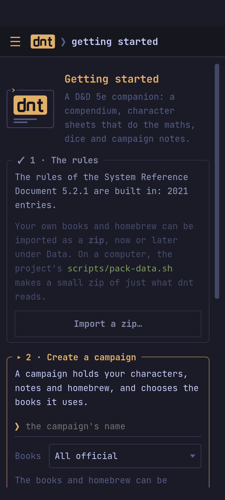
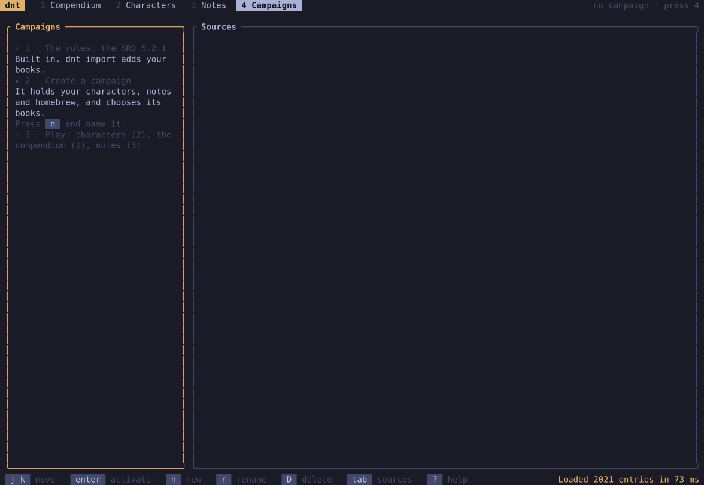
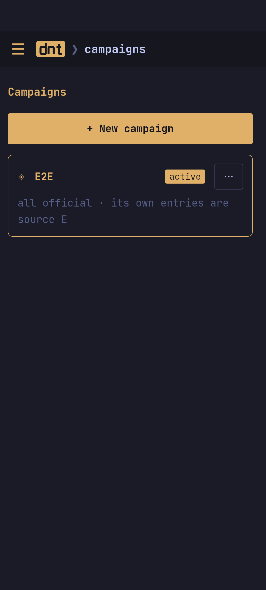

## The rules

dnt has the rules of the **SRD 5.2.1** built in: the classes, species,
backgrounds, feats, spells, items and rules of the free System Reference
Document of the 2024 edition. Nothing to import to start playing.

Your own books and homebrew can be added, in the data format described in
[`schemas/`](https://github.com/v0v3s/dungeons-n-terminals/blob/main/schemas/README.md).
Make one small zip of just what dnt reads, from a data repository and/or a
homebrew collection:

```sh
scripts/pack-data.sh --data path/to/data-repo --homebrew path/to/homebrew -o dnt-data.zip
```

(It needs [Rust](https://rustup.rs) and a checkout of dnt.) The same zip
works for both apps. Where a book has an entry of the SRD (the 2024
*Fireball*), the book's is shown while the book is on.

## The first start

| The app | The terminal app |
| --- | --- |
|  |  |

- **The app** opens on *Getting started*: the rules are there; *Import a
  zip…* adds your books (on a phone, put the zip on the phone first), then
  name your first campaign.
- **The terminal app** asks for your first campaign. Import with
  `dnt import dnt-data.zip`, or read a data folder in place with
  `dnt --data path/to/data`.

Importing again (a newer zip, more homebrew) updates entries instead of
doubling them.

## Campaigns

A campaign holds your characters, notes and homebrew, and chooses the books
it uses. A new one uses all the books; change them with the compendium's
`@` button or the campaign's *⋯ › Books & homebrew* (in the terminal: **4
Campaigns**, `tab` to *Sources*). Imported homebrew is off until a campaign
turns it on.



Next: [[Characters]].
