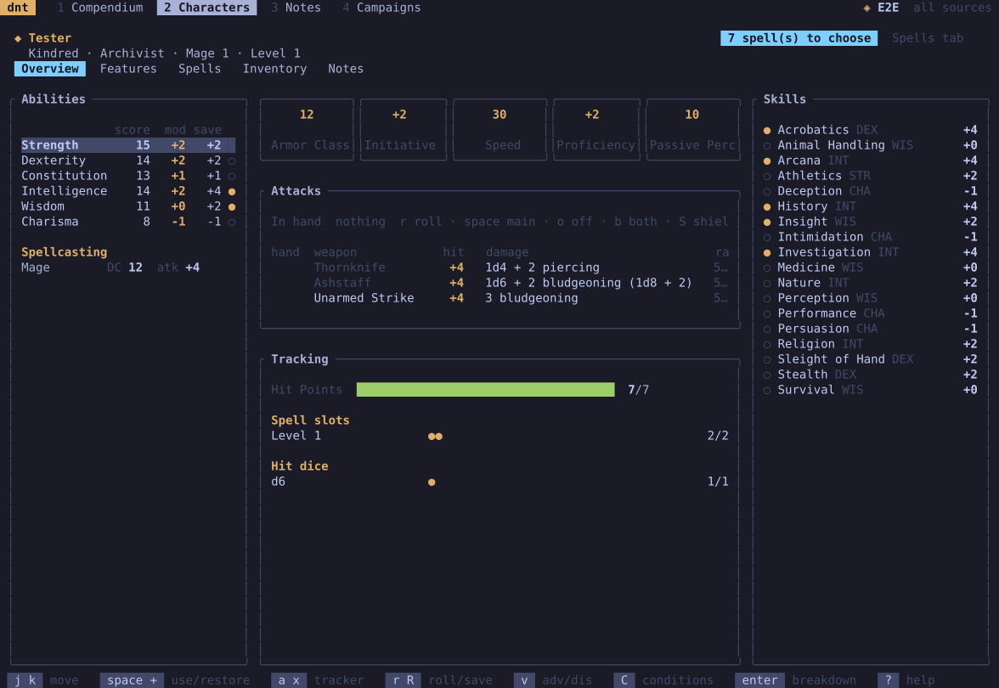

**dnt** (Dungeons & Terminals) is a D&D 5e companion for players: a
compendium, character sheets that do the maths, dice, campaign notes and
campaign homebrew. It comes twice:

- **the terminal app** (`dnt`), for Linux and Windows, made for the keyboard;
- **the app**, for Windows and Android (phones and tablets), in the same
  look, made for touch.

They have the same features. dnt ships no game content: it reads the rules
from data you provide, and works with the 2024 and the 2014 rules.

| The app on a phone | The terminal app |
| --- | --- |
|  |  |

## Start here

1. [[Installing]] the terminal app or the app.
2. [[Getting started]]: import the data, create a campaign.
3. [[Characters]]: create one, level up.
4. [[Playing]]: roll, take damage, rest, track what you use.

Then: [[Compendium]] · [[Spells]] · [[Inventory]] · [[Notes]] ·
[[Homebrew and rules]] · [[Terminal keys]] · [[Files and data]]

dnt is a fan project, not affiliated with Wizards of the Coast. It is free
software under the MIT licence: [source and releases](https://github.com/v0v3s/dungeons-n-terminals).
