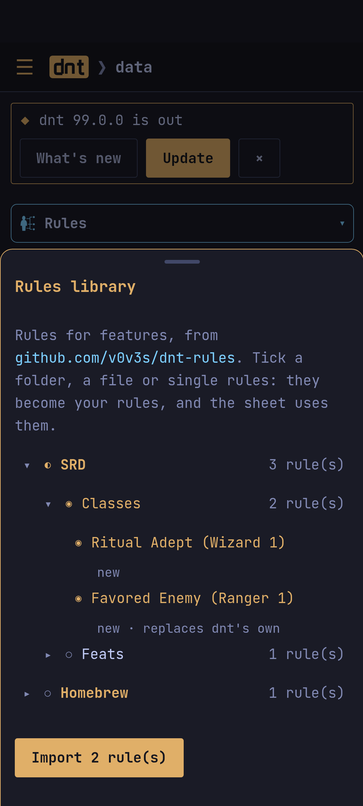

## Homebrew

- **Imported homebrew** (files that name their sources) is off until a
  campaign turns it on (its *⋯ › Books & homebrew › Homebrew*).
- **Campaign homebrew**: clone any entry (a campaign version replaces the
  book's; a copy is a new entry), or make a new spell, item, feat, … from a
  template. Edit it field by field, or as JSON. *Make global* shares it with
  every campaign.

## Rules

A sheet knows a feature's numbers when there are rules for it. dnt ships
rules for many 2024 features; features with rules show `auto` in the
Features tab. For anything else, write them: the feature's *rules* button
(`O` in the terminal). The check shows what they change as you type.

```toml
[[feature]]
id = "classFeature:Brutal Strike|Barbarian|XPHB|9"

[[feature.resource]]
key = "brutal_strike"
name = "Brutal Strike"
max = "prof"
recharge = "long_rest"

[[feature.effect]]
target = "rider.brutal_strike"        # extra damage on a hit
set = "if(class.barbarian.level >= 17, 2d10, 1d10)"
```

Targets include `ac`, `speed`, `hp.max`, `initiative`, `save.dex`,
`skill.stealth`, `attack.bonus`, `rider.<key>` and `resource.<key>.max`;
effects `add`, `set`, `max`, `min` or `mul`, with an optional `when`.
A toggle (`[[feature.toggle]]`) turns effects on and off from the sheet.

Rules grant spells too: a spell, or a choice of spells (by the data's
filter), always prepared, known, or cast free. A free cast is `uses`
times a day, at will without `uses`, or paid with a `resource`.

```toml
[[feature]]
id = "classFeature:Mystic Arcanum|Warlock|XPHB|11"

[[feature.spell]]
choose = "level=6|class=Warlock"       # or: spell = "spell:Fireball|XPHB"
grant = "free"                         # prepared, known or free
uses = 1                               # or: resource = "Soul Fragment"
```

And change attacks: for the weapons a filter picks by their properties
(`weapon.melee`, `weapon.simple`, `weapon.light`, `weapon.two_handed`,
`weapon.both_hands`, …), the ability they use, a damage die used when it
is better, dice that count at least `dice_min` or are rolled again at
`reroll` or less, and a note. With a `kind`, they are a kind of weapon
you mark weapons in or out of in the inventory.

```toml
[[feature]]
id = "classFeature:Martial Arts|Monk|XPHB|1"

[[feature.attack]]
kind = "monk weapon"
weapons = "weapon.melee and (weapon.simple or (weapon.martial and weapon.light))"
ability = "max(mod.str, mod.dex)"
die = "class.monk.martial_arts"        # used when better than the weapon's
```

`[[feature.offhand]]` says which weapons may attack off hand besides Light
ones in both hands: `main` for the main hand's (`main.light`), `off` for
the off hand's (`weapon.melee and not weapon.two_handed`).

A rule asks for a choice when its feature is gained: `ability_increase`
(or a feat of the categories in `feats` instead), `feat`, `expertise` or
`weapon_mastery`. `count` is how many the feature gives in all at a class
level: a number, or a formula of the class table's columns. An id with a
`*` part is every entity with anything there: every class's Ability Score
Improvement in one rule.

```toml
[[feature]]
id = "classFeature:Ability Score Improvement|*|*|*"

[[feature.choice]]
pick = "ability_increase"
feats = ["G"]                          # or a General feat instead

[[feature]]
id = "classFeature:Weapon Mastery|Fighter|XPHB|1"

[[feature.choice]]
pick = "weapon_mastery"
count = "class.fighter.weapon_mastery" # the table's column, at each level
```

A class's features are its own. A book's class made from another (its
version of the Barbarian, say) shares that class's features, but not
its rules: it has rules of its own, which name it.

```toml
[[feature]]
id = "classFeature:Rage|Barbarian|XPHB|1"
class = "Shaman|WoW"                   # the class these rules are for
```

### The rules library

The [rules library](https://github.com/v0v3s/dnt-rules) has rules for the
SRD and for homebrew that dnt does not have built in, and takes pull
requests. Open it from *Data › Rules library* (the app), `L` on
**4 Campaigns** (the terminal app), or `dnt rules`. Tick a folder, a file
or single rules (`space` in the terminal), then import them (`enter`, or
`dnt rules import srd`): they become your rules. Each rule says whether it
is new, yours already, or differs from yours; rules that differ ask first,
one by one (*Overwrite* or *Keep*) or all at once.


