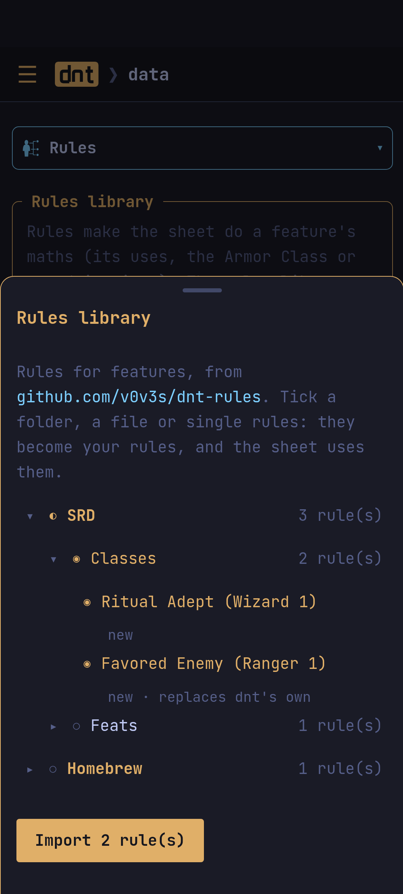

## Homebrew

- **Imported homebrew** (files that name their sources) is off until a
  campaign turns it on (its *⋯ › Books & homebrew › Homebrew*).
- **Campaign homebrew**: clone any entry (a campaign version replaces the
  book's; a copy is a new entry), or make a new spell, item, feat, … from a
  template. Edit it field by field, or as JSON. *Make global* shares it with
  every campaign.

## Rules

A sheet knows a feature's numbers when there are rules for it. dnt ships
rules for many 2024 features; features with rules show `auto` in the
Features tab. For anything else, write them: the feature's *rules* button
(`O` in the terminal). The check shows what they change as you type.

```toml
[[feature]]
id = "classFeature:Brutal Strike|Barbarian|XPHB|9"

[[feature.resource]]
key = "brutal_strike"
name = "Brutal Strike"
max = "prof"
recharge = "long_rest"

[[feature.effect]]
target = "rider.brutal_strike"        # extra damage on a hit
set = "if(class.barbarian.level >= 17, 2d10, 1d10)"
```

Targets include `ac`, `speed`, `hp.max`, `initiative`, `save.dex`,
`skill.stealth`, `attack.bonus`, `rider.<key>` and `resource.<key>.max`;
effects `add`, `set`, `max`, `min` or `mul`, with an optional `when`.
A toggle (`[[feature.toggle]]`) turns effects on and off from the sheet.

### The rules library

The [rules library](https://github.com/v0v3s/dnt-rules) has rules for the
SRD and for homebrew that dnt does not have built in, and takes pull
requests. Open it from *Data › Rules library* (the app), `L` on
**4 Campaigns** (the terminal app), or `dnt rules`. Tick a folder, a file
or single rules (`space` in the terminal), then import them (`enter`, or
`dnt rules import srd`): they become your rules. Each rule says whether it
is new, yours already, or differs from yours; rules that differ ask first,
one by one (*Overwrite* or *Keep*) or all at once.


