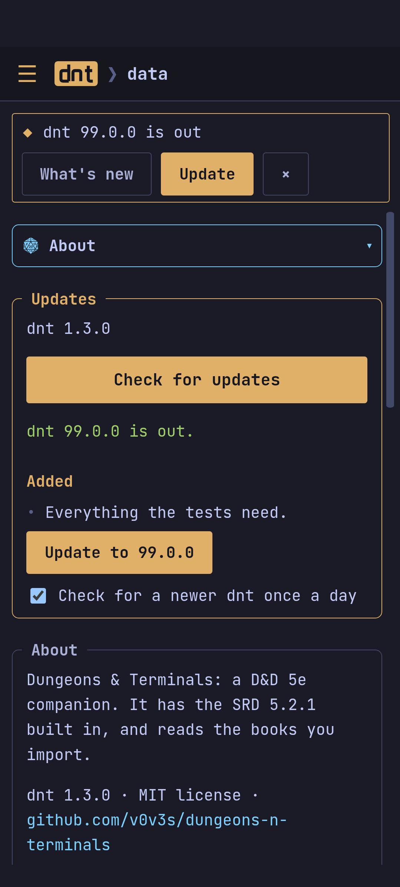

Every [release](https://github.com/v0v3s/dungeons-n-terminals/releases/latest)
has the terminal app and the app, with `SHA256SUMS` to check the downloads.

## The terminal app

**Linux** (x86_64):

```sh
curl -LO https://github.com/v0v3s/dungeons-n-terminals/releases/latest/download/dnt-linux-x86_64
chmod +x dnt-linux-x86_64 && mv dnt-linux-x86_64 ~/.local/bin/dnt
```

**Windows**: download `dnt-windows-x86_64.exe` (rename it to `dnt.exe` if
you like) and run it in Windows Terminal.

**From source**, with [Rust](https://rustup.rs):

```sh
git clone https://github.com/v0v3s/dungeons-n-terminals.git
cd dungeons-n-terminals
cargo build --release      # the binary is target/release/dnt
```

## The app

- **Windows**: `dnt-app-windows-x86_64-setup.exe`, an installer. It is not
  code-signed, so SmartScreen asks first: *More info* › *Run anyway*.
- **Android**: `dnt-app-android.apk`. Open it on the device and allow
  installing from that app (or `adb install -r dnt-app-android.apk`). Newer
  releases install over older ones.

## Updating

dnt checks for a newer version once a day when it starts, and says so; it
asks GitHub for the newest release, nothing else.

- **The app**: a notice says *dnt X is out*: *What's new* shows its notes,
  *Update* downloads it. On Android, Android's installer opens on it:
  confirm, and the first time allow dnt to install apps (Android installs
  it only when it comes from the same signed dnt). On Windows, the
  installer runs. *Data › About* checks by hand, and turns the daily check
  off.
- **The terminal app**: the status line says *dnt X is out*. `dnt update`
  updates it in place, `dnt update --check` says what is new, and
  `dnt update --auto off` stops the daily check.

Every download is checked against the release's `SHA256SUMS` first: one
that does not match is not installed.



The terminal app and the app keep their own campaigns: they do not share
them. Next: [[Getting started]].
