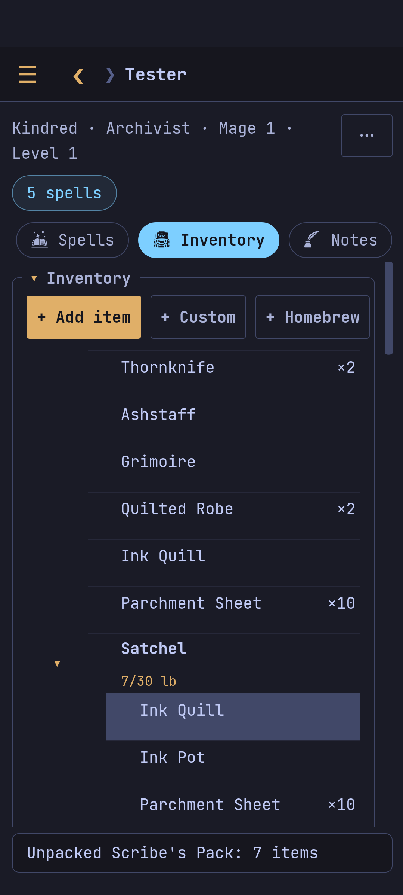

What the character carries, wears and holds, with the weight carried and
the coins.

- **Add** an item from the books, a custom item (just a name), or a new
  homebrew item from a template (`a` in the terminal).
- **A line's menu** (tap it): wear it in a slot or hold it in a hand (AC and
  attacks follow), attune to it (its bonuses follow), one more or one fewer,
  put it into a container or carry it loose, remove it.
- **Packs** (a Scholar's Pack, say) unpack into their container (`p`).
- **Containers** fold their contents away (▾ ▸), take items straight into
  them, and have settings: what they hold, *no limit*, *weightless* (`w`).
  Any item can be made a container.
- **Monk weapons**: a monk marks which weapons count (`m`).
- **Coins**: `+15gp`, `-3sp`, or a number to set the gold (`g`).
