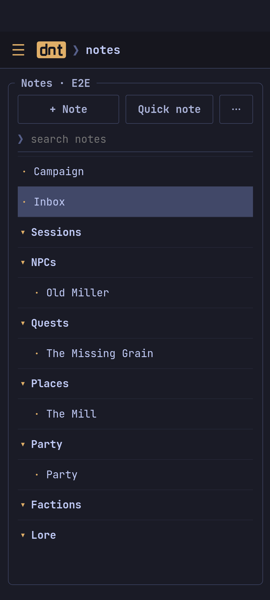
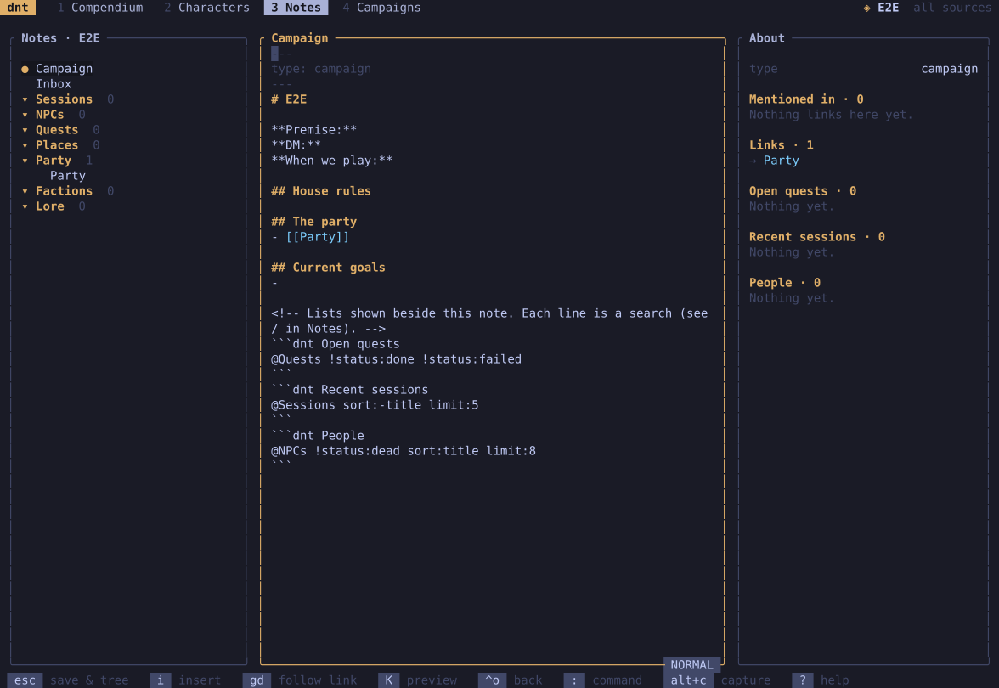

Each campaign has a notebook of Markdown files: folders for Sessions, NPCs,
Quests, Places, the Party, Factions and Lore, a campaign hub and an Inbox.

| | |
| --- | --- |
|  |  |

- **New** notes take their folder's template; **today's session note** is
  named by the date. Notes and folders can be renamed, deleted (after
  asking) and the top-level folders moved up or down.
- **Quick note**: jot something into the Inbox, with the time (`alt+c`
  anywhere in the terminal).
- **Links**: `[[Old Miller]]` links a note, `[[spell:Fireball]]` a
  compendium entry; a link to a missing note creates it. Each note shows
  what links to it.
- **Queries**: a ` ```dnt ` block lists notes that match (open quests, the
  people met, recent sessions); the campaign hub has some to start with.
- **Search**: words, `#tag`, `key:value`, `@Folder`, `!` (not).
- Each character has a note in *Party* (the sheet's **Notes** tab).

In the terminal the editor is vim-like (`i` to type, `esc` to save), with
`:` commands (`:w`, `:e`, `:new`, `:session`, `:inbox`, `:find`).
