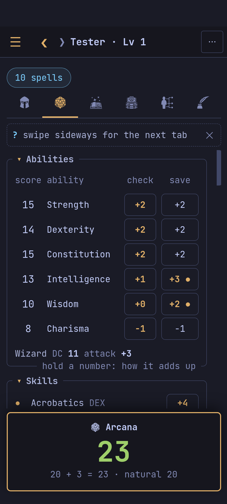

Everything here is on the sheet's **Overview**.

## Rolls

Tap an ability's check or save, a skill, initiative or an attack to roll it
(in the terminal: move to it, `r`; `R` for the saving throw). The chip
*next roll* sets advantage or disadvantage for one roll (`v`). Rolls can go
into the latest session note (*⋯ › Write rolls into the session note*,
`N`).

*Roll dice* (`#` in the terminal) rolls whatever you type, with the
character's numbers by name: `d20 + prof + dex`, `2d6 + str`, `d8 + spell`.
The names are `prof`, the abilities (`str` … `cha`), `spell` (the
spellcasting modifier) and `level`; in the app, tap the d20 beside *next roll*
on the overview, then the dice and the names to build the roll. A lone d20 takes the *next roll* choice.

## Hit points

*Damage* takes temporary hit points first; damage that would kill outright
asks: dead, or dying at 0. While dying, roll death saves; *Not dead* when
you were saved. *Heal*, *Temp* (the higher amount stays). In the terminal:
`d`, `h`, `t`, `D`.

## Rests and what you use

*⋯ › Short rest / Long rest* (`s`, `L`) bring back what they should, after
asking. Spell slots, pact slots, hit dice and feature uses have `−` and `+`
(`space` / `+`); a hit die can be rolled to heal. *+ Tracker* adds one of
your own (`Ring of Warmth, 3, dawn`); removing it asks first.

## Conditions

The *conditions* chip turns conditions on and off and sets the exhaustion
level (`C`). The conditions are those of your books, and their rules say
what each does: to your numbers, and advantage or disadvantage on your
rolls. Concentration shows as a chip; tap it to end it.

## Companions

The **Companions** tab holds the creatures that serve the character: a
familiar, a steed, a summoned spirit, followers. A spell or feature whose
rules give a companion has a button there (*Familiar (Find Familiar)*):
it asks for a creature the rules allow, its type when it has a choice,
and the level the spell is cast at. *Add a follower…* takes any creature.

Each companion has a card of its own: hit points (*Damage*, *Heal*), AC,
speed, its abilities and skills, and its actions; tap a number or an
action to roll it in its name. Its `⋯` shows its stat block, renames it,
sets conditions, sends it away and back, and removes it. A summoned
creature's numbers follow the spell's level and you (your spell attack,
your proficiency bonus), as the spell's [[Homebrew and rules|rules]] say.

A follower of your own (a hireling with no stat block in any book) is
campaign homebrew: make a creature in the compendium (*New*), then add it.

## Attacks

Each attack shows its bonus and damage; its `⋯` holds the weapon in the main
hand, the off hand or both. Shields and armour are worn from the
[[Inventory]].
