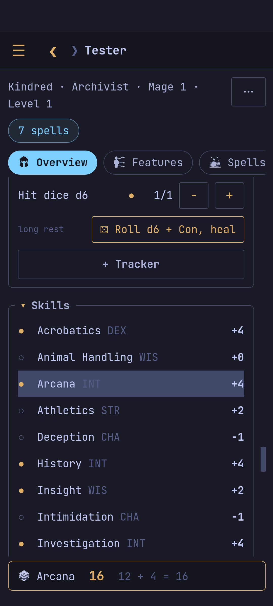

Everything here is on the sheet's **Overview**.

## Rolls

Tap an ability's check or save, a skill, initiative or an attack to roll it
(in the terminal: move to it, `r`; `R` for the saving throw). The chip
*next roll* sets advantage or disadvantage for one roll (`v`). Rolls can go
into the latest session note (*⋯ › Write rolls into the session note*,
`N`).

## Hit points

*Damage* takes temporary hit points first; damage that would kill outright
asks: dead, or dying at 0. While dying, roll death saves; *Not dead* when
you were saved. *Heal*, *Temp* (the higher amount stays). In the terminal:
`d`, `h`, `t`, `D`.

## Rests and what you use

*⋯ › Short rest / Long rest* (`s`, `L`) bring back what they should, after
asking. Spell slots, pact slots, hit dice and feature uses have `−` and `+`
(`space` / `+`); a hit die can be rolled to heal. *+ Tracker* adds one of
your own (`Ring of Warmth, 3, dawn`); removing it asks first.

## Conditions

The *conditions* chip turns conditions on and off and sets the exhaustion
level (`C`). Concentration shows as a chip; tap it to end it.

## Attacks

Each attack shows its bonus and damage; its `⋯` holds the weapon in the main
hand, the off hand or both. Shields and armour are worn from the
[[Inventory]].
