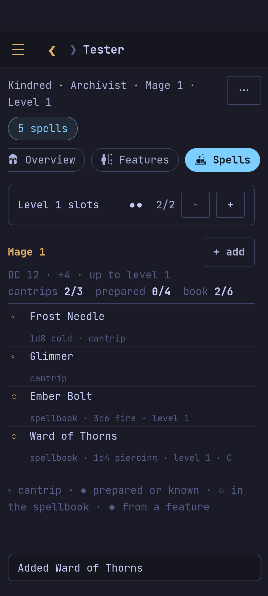

The **Spells** tab lists each casting class with its spell attack and save
DC, what it may still choose, its slots, and the spells: `◦` cantrip, `●`
prepared or known, `○` in the spellbook, `◆` from a feature.

- **Choosing**: *+ add* on a class (`a`) adds its spells; a feat's or a
  species' choice shows as *+ choose …*. The sheet's flag counts the spells
  you may still choose and leads to them.
- **A spell's menu** (tap it; `enter`, `r`, `p`, `f`, `x` in the terminal):
  cast it with a slot (or a free cast, once a day and the like), roll it
  (with its own class's numbers), prepare or unprepare it, make it a
  favourite (favourites come first), remove it.
- Casting a concentration spell marks it; end it from the Overview or with
  `C`.
