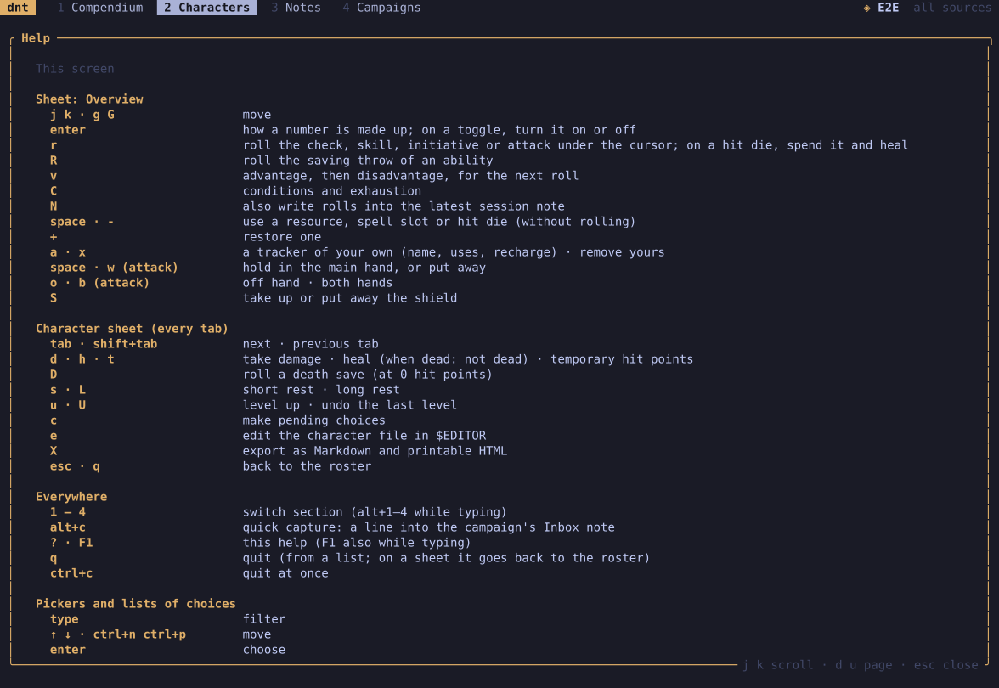

Press `?` on any screen for its keys (`F1` while typing).

| Anywhere | |
| --- | --- |
| `1` `2` `3` `4` | Compendium, Characters, Notes, Campaigns |
| `alt+c` | quick note into the Inbox |
| `q` | back, or quit from a list · `ctrl+c` quits |

| A list or a picker | |
| --- | --- |
| `j` `k` / arrows | move (in a picker, typing filters; arrows move) |
| `enter` | open, choose |
| `esc` | back, cancel |

| The sheet | |
| --- | --- |
| `tab` | next tab |
| `d` `h` `t` | damage, heal, temporary hit points |
| `r` / `R` | roll what is under the cursor / its saving throw |
| `v` | advantage or disadvantage for the next roll |
| `s` / `L` | short / long rest |
| `u` / `U` | level up / undo a level |
| `C` | conditions · on Spells: end concentration |
| `a` / `x` | add / remove (a tracker, a spell, an item) |
| `enter` | how a number adds up |
| `e` / `X` | edit the file / export |

The **command line**: `dnt import FILE`, `dnt imported`,
`dnt forget SOURCE`, `dnt backup`, `dnt backups`, `dnt restore FILE`,
`dnt export character|campaign|entry …`, `dnt reset`, `--data PATH`,
`--homebrew FILE`, `--sources XPHB,XDMG`. See [[Files and data]].
